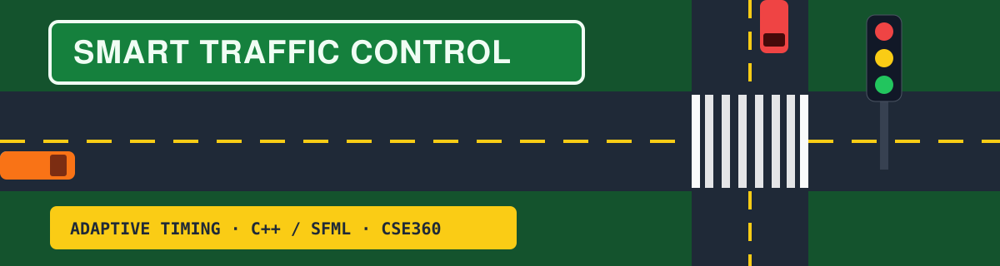

<p align="center">
  
</p>

# 🚦 SMART TRAFFIC CONTROL SIMULATION

## 📋 Mini Project Overview

**Course:** CSE360 - Computer Systems Engineering  
**Project Type:** 🔬 Mini Project  
**Programming Language:** C++/SFML  

---


## 👨‍💻 Developed by

**Developed by [Azizul Abedin Azmi](https://github.com/azizulabedinazmi)**

<div align="center">

[](https://github.com/azizulabedinazmi)

[](https://orcid.org/0009-0003-5269-6900)

</div>

---

## 🚦 Project Title

**Smart Traffic Control System with Adaptive Timing and Real-time Visualization 🎮**

---

## 🎯 Objective

Design and implement an intelligent traffic control system for a four-way intersection with:
- Adaptive traffic light timing
- Pedestrian crossing management
- Real-time visualization and interactive controls
- Emergency vehicle override
- Comprehensive statistics and performance monitoring

---

## 📝 Theory & Algorithm

### Traffic Flow Equation
```
Q = k × v
```
Where Q = flow, k = density, v = speed

### Adaptive Timing Algorithm
```cpp
int calculate_green_time(bool is_ns) {
    if (!adaptive_mode) return 30;
    int main_traffic = is_ns ? (vehicle_counts[NORTH] + vehicle_counts[SOUTH]) : (vehicle_counts[EAST] + vehicle_counts[WEST]);
    int cross_traffic = is_ns ? (vehicle_counts[EAST] + vehicle_counts[WEST]) : (vehicle_counts[NORTH] + vehicle_counts[SOUTH]);
    int traffic_diff = max(0, main_traffic - cross_traffic);
    int extra_time = min(40, traffic_diff * 2);
    return 20 + extra_time;
}
```

### State Machine
- NS_GREEN → NS_YELLOW → EW_GREEN → EW_YELLOW → NS_GREEN
- Green: 20-60s adaptive, Yellow: 5s fixed, Emergency: 15s override

---

## 🏗️ System Architecture

```
┌─────────────────────────────────────────────────┐
│                 MAIN SYSTEM                     │
├─────────────────────────────────────────────────┤
│  ┌─────────────┐  ┌──────────────┐ ┌─────────── │
│  │   Traffic   │  │  Pedestrian  │ │   Visual   │
│  │   System    │  │   Manager    │ │ Interface  │
│  │   Engine    │  │              │ │  (SFML)    │
│  └─────────────┘  └──────────────┘ └─────────── │
│         │                │               │       │
│  ┌─────────────┐  ┌──────────────┐ ┌─────────── │
│  │  Adaptive   │  │  Emergency   │ │Statistics  │
│  │  Algorithm  │  │   Override   │ │Monitor &   │
│  │             │  │              │ │Performance │
│  └─────────────┘  └──────────────┘ └─────────── │
└─────────────────────────────────────────────────┘
```

---

## 💻 Installation & Setup

### Prerequisites
- Linux (Ubuntu 18.04+), Windows 10+, macOS 10.14+
- g++ (C++17), SFML 2.5+

### Install SFML (Ubuntu)
```bash
sudo apt update
sudo apt install -y build-essential g++ cmake libsfml-dev
```

### Clone & Compile
```bash
git clone https://github.com/azizulabedinazmi/smart-traffic-control.git
cd smart-traffic-control/cpp
g++ -std=c++17 -o traffic traffic_system.cpp -lsfml-graphics -lsfml-window -lsfml-system
./traffic
```

---

## 🎮 Controls

| Key | Action |
|-----|--------|
| N/S/E/W | Pedestrian crossing request |
| 1/2/3/4 | Add vehicle (North/South/East/West) |
| T | Toggle adaptive mode |
| A | Toggle auto vehicles |
| M | Emergency override |
| + / - | Adjust simulation speed |
| R | Reset system |
| C | Show/hide config menu |
| Q | Quit application |

---

## 🎮 **QUICK START GUIDE**

### **🚀 Get Started in 3 Steps:**

1. **📥 Clone the repository:**
   ```bash
   git clone https://github.com/azizulabedinazmi/smart-traffic-control.git
   cd smart-traffic-control/cpp
   ```

2. **🔨 Compile and run:**
   ```bash
   g++ -std=c++17 traffic_system.cpp -o traffic -lsfml-graphics -lsfml-window -lsfml-system
   ./traffic
   ```

3. **🎮 Start controlling traffic:**
   - Press `N`, `S`, `E`, `W` for pedestrian crossing requests
   - Press `1`, `2`, `3`, `4` to add vehicles (North, South, East, West)
   - Press `T` to toggle adaptive mode on/off
   - Press `M` for emergency override (15-second all-red)
   - Press `A` to toggle automatic vehicle generation
   - Press `V` to enable/disable sound effects

### **🎮 Control Reference Guide**

**🚶‍♂️ Pedestrian Controls:**
- **N**: Request crossing from North
- **S**: Request crossing from South  
- **E**: Request crossing from East
- **W**: Request crossing from West

**🚗 Vehicle Management:**
- **1**: Add vehicle approaching from North
- **2**: Add vehicle approaching from South
- **3**: Add vehicle approaching from East
- **4**: Add vehicle approaching from West

**⚙️ System Controls:**
- **T**: Toggle adaptive/fixed timing mode
- **A**: Toggle automatic vehicle generation
- **M**: Trigger emergency mode (15-second override)
- **V**: Toggle sound effects on/off
- **+**: Increase simulation speed (up to 5.0×)
- **-**: Decrease simulation speed (down to 0.5×)
- **R**: Reset entire system
- **C**: Show/hide configuration menu
- **Q**: Quit application

**💡 Pro Tips:**
- 🏃‍♂️ Use speed controls (+/-) to test different scenarios quickly
- 📊 Monitor real-time statistics in the right panel for system performance
- 🚑 Try emergency mode during heavy traffic to see immediate override
- 🔄 Use reset (R) to clear statistics and start fresh testing
- 🚶‍♂️ Pedestrian requests during compatible green phases activate immediately
- 🚗 Different vehicle types (cars, trucks, buses, motorcycles) appear randomly

---

## 🚗 Vehicle Types
- **CAR**: 45×22px, Steel Blue
- **TRUCK**: 55×28px, Brown
- **BUS**: 60×25px, Orange
- **MOTORCYCLE**: 35×18px, Green

---

## 📊 Statistics & Features
- Real-time vehicle and pedestrian counts
- Adaptive timing and emergency override
- High-precision runtime tracking
- Visual feedback for all actions

---

## 🧪 Testing & Debugging
- Verified state transitions, adaptive timing, emergency mode, vehicle rendering, pedestrian signals, speed control, and reset functionality
- Stable 60 FPS, <1ms input response, no memory leaks

---

## 🏆 Achievements & Future Work
- Adaptive traffic control, multi-vehicle support, pedestrian management, emergency override, real-time statistics, robust error handling
- Future: Multi-intersection networking, machine learning analytics, mobile interface, IoT integration

---

## 📚 References
- SFML Documentation: https://www.sfml-dev.org/documentation/
- Cormen et al., Introduction to Algorithms
- Papacostas & Prevedouros, Transportation Engineering and Planning
- Federal Highway Administration, Traffic Signal Timing Manual

---

## 🤝 Contribute

- Fork, branch, commit, and open pull requests
- Bug reports, feature requests, documentation, UI/UX, and testing welcome!

---

## 📧 Contact
- GitHub: [Azizul Abedin Azmi](https://github.com/azizulabedinazmi)
- ORCID: [0009-0003-5269-6900](https://orcid.org/0009-0003-5269-6900)

---

**Happy Coding! Make traffic management smarter! 🚦**
